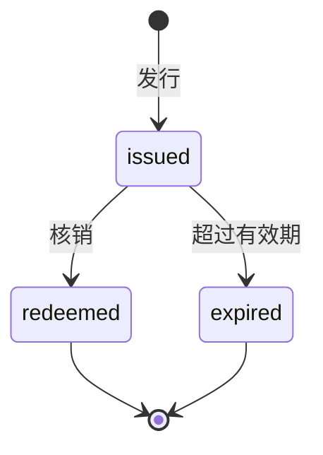

# 代金券规范

本规范定义支付工程中代金券从发行到核销或过期的完整生命周期。金额一律以整数分为单位，币种固定为 CNY。

## 生命周期

代金券由公司发行后进入持有状态，在有效期内可以核销；未核销的券在超过有效期后过期。核销与过期都是终态。

## 概念

- 代金券（Voucher）：由公司发行、记载固定面值的内部预付凭证。它本身就是钱，可抵减应付金额，不能兑回现金。
- 面值（amount）：代金券可抵减的最大金额，整数分。
- 发行来源（source）：代金券产生的原因或劳动类型，采用开放枚举。
- 适用范围（scope）：代金券可核销的业务范围，分为全场、指定业务、指定商品。
- 状态（status）：已发放（issued）、已核销（redeemed）、已过期（expired）。

与相邻概念的区别：优惠券是一条抵扣规则，按比例或门槛计算，本身不是钱；代金券是固定面值的钱。余额是账户资金的投影，代金券是独立的钱，二者在结算中的先后由计费规则决定。

## 总则

- 金额一律使用整数分，禁止浮点。
- 代金券不能兑回现金或余额。
- 未核销且未过期的券面值之和等于账本上的代金券负债。
- 每张券可回溯到发行来源与核销标的。
- 代金券在结算中的先后由计费规则显式给出，不由券自身决定。

## 主题

- [发行](issuance.md) — 创建代金券、记录发行来源并形成负债
- [持有](holding.md) — 券的归属、面值、适用范围与有效期
- [核销](redemption.md) — 抵减应付金额、不找零与剩余结算
- [过期](expiration.md) — 超过有效期后的终态
- [未决事项](open-issues.md) — 结算顺序、发行治理与历史结算等待定问题

代金券的业务洞察见 insight 仓库 `data/insight/voucher/index.md`。
