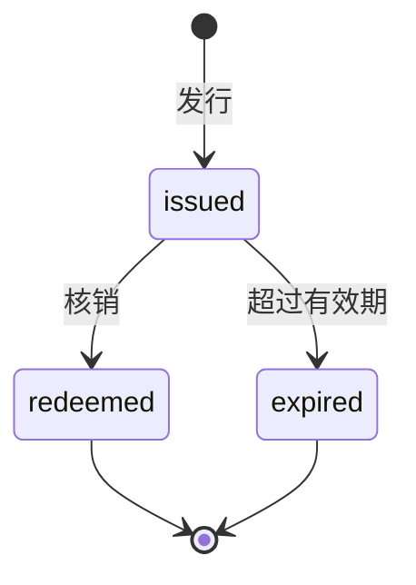

# 代金券规范

本规范定义支付工程中代金券从发行到核销或过期的完整生命周期。金额一律以整数分为单位，币种固定为 CNY。

## 概念

- 代金券（Voucher）：由公司发行、记载固定面值的内部预付凭证。它本身就是钱，可抵减应付金额，不能兑回现金。
- 面值（amount）：代金券可抵减的最大金额，整数分。
- 发行来源（source）：代金券产生的原因或劳动类型，采用开放枚举。
- 适用范围（scope）：代金券可核销的业务范围，分为全场、指定业务、指定商品。
- 状态（status）：已发放（issued）、已核销（redeemed）、已过期（expired）。

与相邻概念的区别：优惠券是一条抵扣规则，按比例或门槛计算，本身不是钱；代金券是固定面值的钱。余额是账户资金的投影，代金券是独立的钱，二者在结算中的先后由计费规则决定。

## 基本约束

- 金额一律使用整数分，禁止浮点。
- 代金券不能兑回现金或余额。
- 未核销且未过期的券面值之和等于账本上的代金券负债。
- 每张券可回溯到发行来源与核销标的。
- 代金券在结算中的先后由计费规则显式给出，不由券自身决定。

## 生命周期

代金券由公司发行后进入持有状态，在有效期内可以核销；未核销的券在超过有效期后过期。核销与过期都是终态。

### 发行

发行阶段创建代金券，记录发行来源，并形成公司负债。发行时生成全局唯一的 id，记录持券账户、整数分面值、发行时间与状态 issued。发行来源采用开放枚举，未知来源保留原值，不得归并为 UNKNOWN。每次发行对应唯一 id，一张券只对应一次发行事件。

形式化规则为 `issue(a, amount, source, scope, expiresAt) -> v`：前置 `amount > 0` 且为整数分，后置 `status = issued`、`issuedAt = now`，并形成面值为 amount 的公司负债。

### 持有

发行后进入持有阶段。代金券归属持券账户，面值固定，适用范围（全场、指定业务或指定商品）与有效期在发行时确定，持有期间不得改变。持有期间券不能兑回现金或余额。

### 核销

核销发生在订单结算时。前置条件是券状态为 issued、当前时间早于 expiresAt、核销标的落在 scope 内，并按计费规则轮到使用代金券。一次核销消耗整张券，不拆分、不做部分使用；面值大于应付金额时，超出部分不回退、不转为余额。账本记录实际抵减额，剩余应付按计费规则的后续工具继续结算。一张券最多核销一次，核销后状态为 redeemed 并记录核销时间。

形式化规则为 `redeem(v, o, r) -> Transaction`，实际抵减额 `applied = min(v.amount, payable(o))`；后置 `status = redeemed`、`redeemedAt = now`，账本记录 applied，差额不找零、不回退，剩余应付继续按 r 结算。

### 过期

未核销的代金券在超过有效期后进入过期状态。状态为 issued 且当前时间达到或超过 expiresAt 时，券转为 expired；expired 是终态，不得再核销，也不得再转移。

形式化规则为 `expire(v, now) -> v'`：前置 `status = issued` 且 `now >= expiresAt`，后置 `status = expired`。
